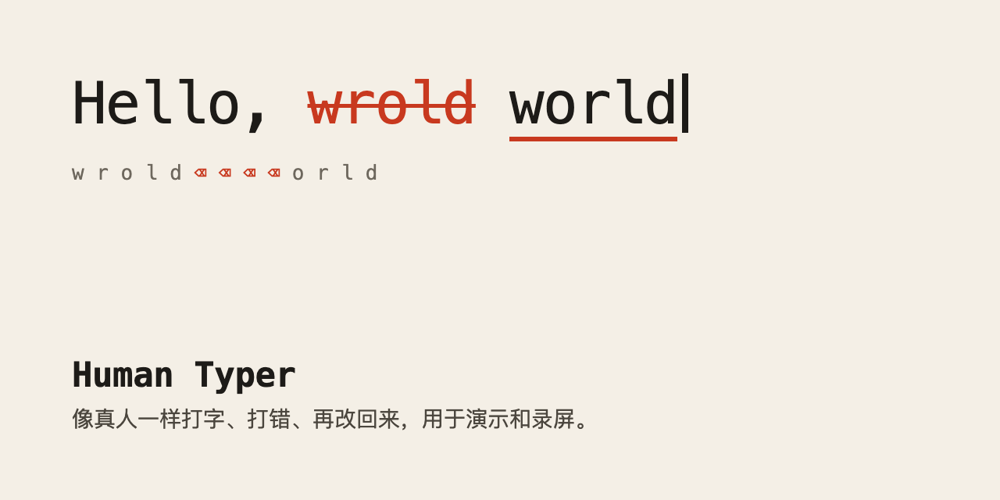

# Human Typer



一个用于产品演示和录屏的 macOS 浏览器插件：把文本以接近真人的节奏打到当前光标位置，偶尔打错，再退格改正。画面上不会出现浏览器的调试提示条。

本项目面向演示和录屏。请勿用它冒充人工操作，例如应付考试监考、作业写作过程检查或平台规则。

## 功能

- 可调速度、出错率和停顿强度
- 英文打错为相邻键或相邻字母互换，中文按词组上屏，错误来自同音字
- 碰键盘、鼠标或切换应用时立即停止，之后可从中断处继续
- 支持 `input`、`textarea` 和 `contenteditable`，英文和拼音输入法下均已测试

## 安装

需要 macOS、Chrome 或 Arc，以及 Xcode Command Line Tools。

1. 运行 `./install.sh`，编译本地程序并注册到浏览器。
2. 打开 `chrome://extensions`，开启开发者模式，点“加载已解压的扩展程序”，选择 `extension` 目录。
3. 在“系统设置 → 隐私与安全性 → 辅助功能”中允许 `build/human-typer-host`。重新编译后需要删除并重新添加。

## 使用

1. 打开插件，粘贴文本并设置参数，点开始。
2. 在 5 秒内点进目标输入框，之后不要操作键盘和鼠标。
3. 如果被打断，点继续，并在 5 秒内把光标放回原位。

## 已知限制

- 仅支持 macOS。
- 程序读不到输入框内容，无法校验结果，页面的自动补全等干扰不会被发现。
- 只切换同一浏览器内的标签页不会停止，字符会打到新标签页。
- 换行以 Return 键发送，在聊天类输入框中可能直接发送消息。
- 切换应用的瞬间，可能有 1 个字符漏到新应用。

## 测试

```bash
npm test
swiftc host/tests/main.swift host/Core.swift -o build/host-tests && build/host-tests
```

端到端测试会向一个独立的临时 Chrome 发送真实按键，运行期间不要操作电脑：

```bash
swiftc tests/e2e/helper.swift -o build/e2e-helper
node tests/e2e/run.mjs
```
